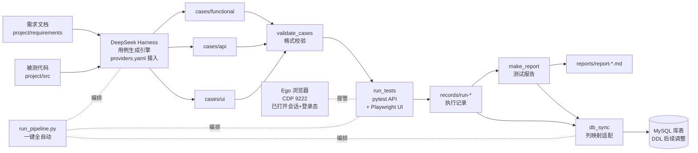

# DSH 测试工作流

基于工作区代码与需求内容的一站式全自动测试工作流：
**功能用例 → API 用例 → UI 用例 → 执行测试 → 执行记录 → 测试报告 → 过程数据回流 MySQL**

- 用例生成引擎：**DeepSeek Harness**（对接已有项目，配置入口 `config/providers.yaml`）
- UI 执行通道：**CDP 接管**、独立 Playwright 实例，或 **ego-browser Skill（CLI + JS）**
- MySQL 回流：**预留配置入口**，等 DDL 后只改映射配置，不改代码

## 安装到 DeepSeek Harness

本仓库已是标准 **DSH Bundle 插件**（`package.json` 的 `dsh.bundle.patch` + `cordis.patch.yml`），
同时自带 `skills/dsh-workflow/SKILL.md` 供 Agent 读取。

```bash
# 本地开发安装（link 到当前目录，无需发布）
dsh plugin --profile web add link:/absolute/path/to/dsh-workflow

# 发布后安装
dsh plugin --profile web add github:<owner>/<repo>#main

# 验证插件出现在最终组合中
dsh web --dump-config | grep dsh-workflow
```

安装后插件注册工具 `dsh_workflow_run`，参数：`only`（api/ui/all）、`skipGen`、`dryDb`、`noDb`、`timeoutSec`。
插件配置：`python`、`workflowDir`、`timeoutSec`。
兼容范围：`engines.dsh: ^0.2.0-rc.1`，已声明兼容 `0.2.1-alpha.3` 与 `0.2.1-rc.3`。

## 架构总览



形态：**DSH Bundle 插件 + Skill + Python 脚本**。`lib/index.js` 注册 `dsh_workflow_run` 工具；
`skills/dsh-workflow/SKILL.md` 负责对话式编排；`scripts/run_pipeline.py` 一键全自动。

## 目录说明

```
dsh-workflow/
├── package.json             # DSH Bundle 插件清单
├── cordis.patch.yml         # 插件挂载配置（id: dsh-workflow）
├── src/index.ts             # 插件源码
├── lib/index.js             # 插件运行入口（已编译，安装即用）
├── skills/dsh-workflow/     # 插件自带 Skill（Harness 自动发现）
├── config/
│   ├── workflow.yaml        # 总配置：被测地址、执行策略、目录、MySQL 表映射
│   ├── providers.yaml       # 外部接入：Harness / EGO CDP / Skill 白名单
│   ├── mysql.example.env    # MySQL 连接模板（复制为 mysql.env 填写）
│   └── mysql.env            # 真实连接信息（不提交、不上传）
├── project/
│   ├── requirements/        # ① 放需求文档
│   └── src/                 # ② 放被测代码
├── cases/                   # ③ 用例产出区（三类 YAML）
│   ├── functional/  ├── api/  └── ui/
├── tests/                   # 数据驱动执行器（无需手改）
│   ├── api/test_api_cases.py   # 读 cases/api/*.yaml 参数化执行
│   └── ui/test_ui_cases.py     # Playwright / ego_skill 双模式 UI 执行器
├── records/<run_id>/         # ④⑤ 执行记录（junitxml/日志/summary/明细/runtime）
├── reports/report-<run_id>.md / .json # ⑥ 测试报告
├── scripts/
│   ├── dsh_common.py        # 公共工具
│   ├── validate_cases.py    # 用例格式校验
│   ├── run_tests.py         # 测试执行编排
│   ├── make_report.py       # 报告生成
│   └── db_sync.py           # MySQL 回流（列映射适配你已有表）
└── skill/dsh-workflow/      # Loomy Skill 编排层
```

## 快速开始

```bash
# 0. 安装依赖（cdp 模式不需要 playwright install 内核；local 模式需要）
pip install -r requirements.txt
# local 模式另需: playwright install chromium

# 1. 把需求文档与被测代码分别放入 project/requirements/ 与 project/src/

# 2. 配置被测地址：config/workflow.yaml
#    api_base_url / ui_base_url
#    ui_mode: cdp        # 接管已打开的浏览器（启动需带 --remote-debugging-port=9222）
#    ui_mode: local      # 或独立 Playwright 实例
#    ui_mode: ego_skill  # 或用 ego-browser Skill（需 npx skills add citrolabs/ego-lite）

# 3a. 已接入 DeepSeek Harness：填 config/providers.yaml（mode/command 或 http_endpoint），
#     enabled: true，然后一键全自动：
python3 scripts/run_pipeline.py

# 3b. 未接入 harness：手写/由 Loomy 生成用例 YAML 放入 cases/，再：
python3 scripts/run_pipeline.py --skip-gen

# 分步执行（调试用）：
python3 scripts/validate_cases.py        # 校验
python3 scripts/run_tests.py             # 执行 + 记录
python3 scripts/make_report.py           # 报告
python3 scripts/db_sync.py --dry-run     # 入库演练
python3 scripts/db_sync.py               # 正式回流
```

## 对接你已有的 DeepSeek Harness

编辑 `config/providers.yaml → harness` 段：

```yaml
harness:
  enabled: true
  mode: command                    # 或 http
  command: "python3 /path/to/harness/run.py --req {requirements} --src {source} --out {output} --run-id {run_id}"
  # http 模式: http_endpoint: http://127.0.0.1:9000/generate
  timeout_sec: 600
  output_dir: records/harness-output
```

**产物约定**（适配层自动分发到 cases/ 并校验格式）：`{output}/functional/*.yaml`、`{output}/api/*.yaml`、`{output}/ui/*.yaml`。

## EGO 浏览器两种执行模式

### 模式一：CDP 接管（默认）

1. 启动 ego lite 时带调试端口：`Ego --remote-debugging-port=9222`
2. `config/workflow.yaml` 设 `ui_mode: cdp`；端点以 `providers.yaml → ego_browser.cdp_endpoint` 为准
3. Playwright 接管已打开会话，每条用例新开标签页，执行完只关测试页

### 模式二：ego-browser Skill（需额外安装）

EGO Skill 不是 HTTP 服务，而是本地 CLI + JS 工具层。安装方式：

```bash
npx skills add citrolabs/ego-lite
# 或安装 ego lite 应用并完成 onboarding， ego-browser 会注册到 ~/.local/bin
ego-browser skill          # 打印与当前版本匹配的 usage guide
```

配置：`config/workflow.yaml` 设 `ui_mode: ego_skill`；`providers.yaml → ego_browser` 中可设
`cli_path`、`nodejs_timeout_sec`、`skill_guide_cache`、`auto_refresh_guide` 与 `skill_whitelist`。

UI DSL 支持 `skill <技能名> <JSON参数>`，真实可用技能来自运行时指南，例如：

```yaml
- action: "skill snapshot {\"scope\": \"full_page\"}"
- action: "skill capture {}"
- action: "skill evaluate {\"script\": \"() => document.title\"}"
- action: "skill fetch {\"url\": \"/api/items\"}"
- action: "skill cdp {\"method\": \"Page.captureScreenshot\", \"params\": {\"format\": \"png\"}}"
```

技能名必须在 `skill_whitelist` 中；未知技能会明确失败并提示查看缓存的 usage guide。
`ego_skill` 模式下整条 UI 用例由 `ego-browser nodejs` 执行，不依赖 Playwright。

## MySQL 回流（预留入口，DDL 后续调整）

1. 复制 `config/mysql.example.env` 为 `config/mysql.env`，填入连接信息
2. 在 `config/workflow.yaml` 中把 `db.enabled` 改为 `true`
3. 用 `python3 scripts/db_sync.py --suggest-ddl` 查看默认映射的建议表结构，与你的表比对
4. 差异通过 `workflow.yaml → db.columns` 做列名映射，**无需改脚本**：

```yaml
db:
  columns:
    case_table:
      case_id: case_no        # dsh 字段 -> 你的列名
      title: case_name
      precondition: null      # 你的表没有这列时置 null，写入时自动跳过
    run_table: {}
    case_result_table: {}
    report_table: {}
```

5. `--dry-run` 演练确认 SQL 无误后正式入库；重复执行按 run_id / case_id 幂等更新

## 常用命令速查

| 命令 | 作用 |
| --- | --- |
| `python3 scripts/run_pipeline.py` | **一键全自动**：生成→校验→执行→记录→报告→回流 |
| `python3 scripts/run_pipeline.py --skip-gen` | 用例已就绪，跳过生成阶段 |
| `python3 scripts/case_gen/harness_adapter.py` | 单独调 DeepSeek Harness 生成用例 |
| `python3 scripts/validate_cases.py` | 校验三类用例格式 |
| `python3 scripts/run_tests.py --only api` | 只跑接口测试 |
| `python3 scripts/run_tests.py --only ui` | 只跑 UI 测试（按 ui_mode 走 cdp/local） |
| `python3 scripts/make_report.py --run run-xxx` | 对指定批次出报告 |
| `python3 scripts/db_sync.py --dry-run` | 入库演练 |
| `python3 scripts/db_sync.py --suggest-ddl` | 查看建议建表语句 |

## 注意事项

- `tests/` 是数据驱动执行器：新增用例只改 `cases/`，不要动执行器
- 一次流水线只有一个 `run_id`，由流水线统一生成并注入用例、记录、报告、库表
- 执行策略在 `config/workflow.yaml → execute`：`fail_fast` / `retry_count` / `timeout_sec` / `cleanup_cases_before_gen` / `harness_failure_policy`
- 返回码：0 全通过；1 有用例失败（报告与入库照常走）；2 流程异常中断；3 CDP 连不上浏览器（流水线透传）
- cdp 模式下执行器只新增/关闭测试标签页，不会关闭你的浏览器和已有会话
- harness 未接入时流水线自动提示跳过生成阶段；用例可由 Harness 生成或手写
- 请求/响应报文入库前自动脱敏（password/token/authorization）
- `config/mysql.env` 含密码，已列入 `.gitignore`，请勿提交或外发
