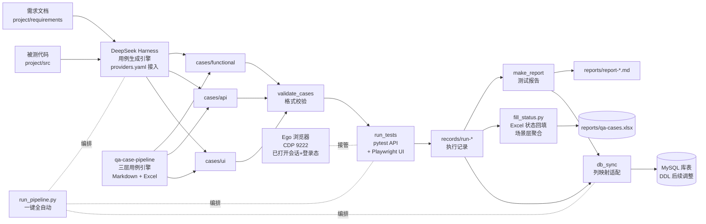

# DSH 测试工作流

基于工作区代码与需求内容的一站式全自动测试工作流：
**功能用例 → API 用例 → UI 用例 → 执行测试 → 执行记录 → 测试报告 → 过程数据回流 MySQL**

- 用例生成引擎：**DeepSeek Harness**（对接已有项目，配置入口 `config/providers.yaml`），
  也可切换为 **qa-toolkit / qa-case-pipeline**（三层用例：场景 / 接口 / UI）
- UI 执行通道：**CDP 接管**、独立 Playwright 实例，或 **ego-browser Skill（CLI + JS）**
- 用例集产物：**Markdown + Excel 三层用例集**，执行后自动回填状态并聚合场景层结论
- MySQL 回流：**预留配置入口**，等 DDL 后只改映射配置，不改代码

## 安装到 DeepSeek Harness

本仓库已是标准 **DSH Bundle 插件**（`package.json` 的 `dsh.bundle.patch` + `cordis.patch.yml`），
同时自带 `skills/dsh-workflow/SKILL.md` 供 Agent 读取。

```bash
# 本地开发安装（link 到当前目录，无需发布）
dsh plugin --profile web add link:/absolute/path/to/dsh-workflow

# 发布后安装
dsh plugin --profile web add github:<owner>/<repo>#main

# 验证插件出现在最终组合中
dsh web --dump-config | grep dsh-workflow
```

安装后插件注册工具 `dsh_workflow_run`，参数：`only`（api/ui/all）、`skipGen`、`dryDb`、`noDb`、`timeoutSec`。
插件配置：`python`、`workflowDir`、`timeoutSec`。
兼容范围：`engines.dsh: ^0.2.0-rc.1`，已声明兼容 `0.2.1-alpha.3` 与 `0.2.1-rc.3`。

### 预检与步骤确认

识别到“全链路测试”意图后，插件先执行 `scripts/preflight.py`（只读、不启动浏览器、不写库），
输出阻塞项、提示项与工作流步骤计划，并通过 `ctx.userQuestions` 弹窗让用户选择 `开始执行 / 取消`。
存在阻塞项时直接返回，不进入执行阶段；无弹窗服务时需确认后带 `confirmed=true` 调用。

### 被测系统与 SSO 登录

若调用 `dsh_workflow_run` 时未传 `targetUrl`，插件会通过 DSH 提问弹窗收集：

- 被测系统链接（必须 `http://` / `https://`）
- SSO 账号
- SSO 密码
- 确认项：`确认并启动` / `取消`

确认后插件会启动 EGO（macOS：`open -a "ego lite"`）、打开链接并尝试自动登录。
若无法自动登录，会保留浏览器会话并调用 `task.handOff()`，提示你在 EGO 中手动登录后再重试。
密码仅通过进程环境变量一次性传递，不写配置、用例、报告或数据库，且返回文本中会被脱敏。

## 架构总览



形态：**DSH Bundle 插件 + Skill + Python 脚本**。`lib/index.js` 注册 `dsh_workflow_run` 工具；
`skills/dsh-workflow/SKILL.md` 负责对话式编排；`scripts/run_pipeline.py` 一键全自动。

## 目录说明

```
dsh-workflow/
├── package.json             # DSH Bundle 插件清单
├── cordis.patch.yml         # 插件挂载配置（id: dsh-workflow）
├── src/index.ts             # 插件源码
├── lib/index.js             # 插件运行入口（已编译，安装即用）
├── skills/dsh-workflow/     # 插件自带 Skill（Harness 自动发现）
├── config/
│   ├── workflow.yaml        # 总配置：被测地址、执行策略、目录、MySQL 表映射
│   ├── providers.yaml       # 外部接入：Harness / EGO CDP / Skill 白名单
│   ├── mysql.example.env    # MySQL 连接模板（复制为 mysql.env 填写）
│   └── mysql.env            # 真实连接信息（不提交、不上传）
├── project/
│   ├── requirements/        # ① 放需求文档
│   └── src/                 # ② 放被测代码
├── cases/                   # ③ 用例产出区（三类 YAML）
│   ├── functional/  ├── api/  └── ui/
├── tests/functional/        # 功能（场景层）执行器：有 checks 才机判，否则显式 skipped
├── tests/                   # 数据驱动执行器（无需手改）
│   ├── api/test_api_cases.py   # 读 cases/api/*.yaml 参数化执行
│   └── ui/test_ui_cases.py     # Playwright / ego_skill 双模式 UI 执行器
├── records/<run_id>/         # ④⑤ 执行记录（junitxml/日志/summary/明细/runtime/bugs 快照）
│   └── playwright/           # Playwright 定位脚本产物（*.e2e.ts + index + config + manifest）
├── records/bugs.json         # 缺陷台账主表（跨批次累积，含状态与流转留痕）
├── reports/report-<run_id>.md / .json # ⑥ 测试报告
├── reports/qa-cases.md / .xlsx        # qa-toolkit 三层用例集（生成 + 状态回填）
├── scripts/
│   ├── dsh_common.py        # 公共工具
│   ├── validate_cases.py    # 用例格式校验
│   ├── run_tests.py         # 测试执行编排
│   ├── make_report.py       # 报告生成（附带场景层聚合与 Excel 回填）
│   ├── qa_casepipe.py       # qa-toolkit 融合适配层（生成/翻译/回填/聚合）
│   ├── case_aggregate.py    # 用例关联索引 + 功能（场景层）状态派生
│   ├── import_external_results.py  # 外部执行结果导入器（把别的通道结果接进本账本）
│   ├── bug_tracker.py       # 缺陷台账（要素模型 + 状态机 + 同根因归并 + 流转留痕）
│   ├── gen_playwright.py    # Playwright 定位脚本产物（DSL 生成 + 外部脚本导入）
│   ├── ego_client.py        # ego-browser Skill 适配（DSL→JS，含高级交互）
│   ├── ego_learnings.py     # ego-browser 领域工具包发现/执行（GitHub/Google/X）
│   ├── qa_extended.py       # qa-toolkit 扩展能力阶段入口
│   └── db_sync.py           # MySQL 回流（列映射适配你已有表）
└── skill/dsh-workflow/      # Loomy Skill 编排层
```

## 快速开始

```bash
# 0. 安装依赖（cdp 模式不需要 playwright install 内核；local 模式需要）
pip install -r requirements.txt
# local 模式另需: playwright install chromium

# 1. 把需求文档与被测代码分别放入 project/requirements/ 与 project/src/

# 2. 配置被测地址：config/workflow.yaml
#    api_base_url / ui_base_url
#    ui_mode: cdp        # 接管已打开的浏览器（启动需带 --remote-debugging-port=9222）
#    ui_mode: local      # 或独立 Playwright 实例
#    ui_mode: ego_skill  # 或用 ego-browser Skill（需 npx skills add citrolabs/ego-lite）

# 3a. 已接入 DeepSeek Harness：填 config/providers.yaml（mode/command 或 http_endpoint），
#     enabled: true，然后一键全自动：
python3 scripts/run_pipeline.py

# 3b. 未接入 harness：手写/由 Loomy 生成用例 YAML 放入 cases/，再：
python3 scripts/run_pipeline.py --skip-gen

# 分步执行（调试用）：
python3 scripts/validate_cases.py        # 校验
python3 scripts/run_tests.py             # 执行 + 记录
python3 scripts/make_report.py           # 报告
python3 scripts/db_sync.py --dry-run     # 入库演练
python3 scripts/db_sync.py               # 正式回流
```

## 对接你已有的 DeepSeek Harness

编辑 `config/providers.yaml → harness` 段：

```yaml
harness:
  enabled: true
  mode: command                    # 或 http
  command: "python3 /path/to/harness/run.py --req {requirements} --src {source} --out {output} --run-id {run_id}"
  # http 模式: http_endpoint: http://127.0.0.1:9000/generate
  timeout_sec: 600
  output_dir: records/harness-output
```

**产物约定**（适配层自动分发到 cases/ 并校验格式）：`{output}/functional/*.yaml`、`{output}/api/*.yaml`、`{output}/ui/*.yaml`。

## 集成 qa-toolkit（qa-case-pipeline 三层用例流水线）

`qa-toolkit`（插件包 `dsh-qa-casepipe`）提供的是**三层用例方法论 + 一套可复用脚本**：

| 层 | 内容 | qa-toolkit 产物 | DSH 侧落点 |
| --- | --- | --- | --- |
| 场景层 | 核心链路用例（编号/链路/步骤/预期） | Excel `核心链路用例` | `cases/functional/qa-pipeline.functional.yaml` |
| 接口层 | 接口用例（方法/URL/请求体/断言） | Excel `API接口用例` | `cases/api/qa-pipeline.api.yaml` |
| UI 层 | Playwright 步骤用例 | Excel `UI用例(Playwright)` | `cases/ui/qa-pipeline.ui.yaml` |

### 1. 作为用例生成引擎（provider: qa_casepipe）

把 `config/providers.yaml → harness.provider` 改成 `qa_casepipe`，生成阶段就由 qa-case-pipeline 承担：

```yaml
harness:
  enabled: true
  provider: qa_casepipe      # harness | qa_casepipe

qa_casepipe:
  enabled: true
  spec: project/requirements/qa-spec.json     # spec JSON（meta/scenarios/api/ui）
  scripts_dir: ""                              # 留空自动探测
  outputs:
    md: reports/qa-cases.md
    xlsx: reports/qa-cases.xlsx
  sheets:
    scenario: 核心链路用例
    api: API接口用例
    ui: UI用例(Playwright)
```

流程：

1. `gen_cases.py` 把 spec 渲染成 `reports/qa-cases.md` + `reports/qa-cases.xlsx`（三层工作表）；
2. 同一份 spec 再转成 `cases/functional|api|ui/*.yaml`，交给原有校验器与执行器；
3. UI 层的 Playwright 片段做**保守翻译**为 EGO DSL（`getByTestId` → `loc=css:[data-testid=…]`、
   `getByRole` → `loc=role:…[name="…"]`、`goto/fill/toHaveText` 等），翻译不了的断言会以
   `notes` 写进用例并在生成日志里提示，不会静默丢弃；
4. `validate_cases.py` 继续校验三类用例，通过后进入执行阶段。

脚本目录探测顺序：`qa_casepipe.scripts_dir` → 环境变量 `DSH_QACASEPIPE_DIR` →
`node_modules/dsh-qa-casepipe/...` → 同级 `../qa-toolkit/skill/qa-case-pipeline/scripts` →
`~/.dsh/profiles/*/node_modules/dsh-qa-casepipe/...`。

### 2. 作为状态回填与场景层聚合（qa_casepipe.enabled）

报告阶段（`scripts/make_report.py`）会自动：

- 把执行明细映射成 qa-case-pipeline 状态词表（`通过 / 部分通过 / 阻塞 / 未执行 / 失败`），
  写入 `records/<run_id>/qa-casepipe-results.json`；
- 调用 `fill_status.py` 回填 Excel：先写 UI 层，再写接口层并**按 related 关系聚合场景层**
  （失败 > 部分通过 > 阻塞 > 通过 > 未执行），同时生成 `统计与说明` 工作表的 COUNTIF 统计；
- 在 Markdown 报告里新增「场景层状态统计」章节，并在结构化报告的 `qa_pipeline` 字段中给出
  场景级结论与回填结果。

### 3. 插件间协作

`dsh-qa-casepipe` 插件向宿主提供 `ctx.qaCasepipe`（含 `skillDir` / `assetsDir`）。
本插件在启动时读取该服务，把它的 `scripts` 目录通过 `DSH_QACASEPIPE_DIR` 传给全部 Python 脚本；
若未安装该插件，则退回自动探测或插件配置 `casepipeDir`：

```yaml
# cordis.patch.yml
config:
  casepipeDir: ""   # 留空则用 ctx.qaCasepipe.skillDir，再留空则自动探测
```

## EGO 浏览器两种执行模式

### 模式一：CDP 接管（默认）

1. 启动 ego lite 时带调试端口：`Ego --remote-debugging-port=9222`
2. `config/workflow.yaml` 设 `ui_mode: cdp`；端点以 `providers.yaml → ego_browser.cdp_endpoint` 为准
3. Playwright 接管已打开会话，每条用例新开标签页，执行完只关测试页

### 模式二：ego-browser Skill（需额外安装）

EGO Skill 不是 HTTP 服务，而是本地 CLI + JS 工具层。安装方式：

```bash
npx skills add citrolabs/ego-lite
# 或安装 ego lite 应用并完成 onboarding， ego-browser 会注册到 ~/.local/bin
ego-browser skill          # 打印与当前版本匹配的 usage guide
```

配置：`config/workflow.yaml` 设 `ui_mode: ego_skill`；`providers.yaml → ego_browser` 中可设
`cli_path`、`nodejs_timeout_sec`、`skill_guide_cache`、`auto_refresh_guide` 与 `skill_whitelist`。

UI DSL 支持 `skill <技能名> <JSON参数>`，真实可用技能来自运行时指南，例如：

```yaml
- action: "skill snapshot {\"scope\": \"full_page\"}"
- action: "skill capture {}"
- action: "skill evaluate {\"script\": \"() => document.title\"}"
- action: "skill fetch {\"url\": \"/api/items\"}"
- action: "skill cdp {\"method\": \"Page.captureScreenshot\", \"params\": {\"format\": \"png\"}}"
```

技能名必须在 `skill_whitelist` 中；未知技能会明确失败并提示查看缓存的 usage guide。
`ego_skill` 模式下整条 UI 用例由 `ego-browser nodejs` 执行，不依赖 Playwright。

## 功能（场景层）用例与外部结果导入

### 功能（场景层）用例不再"只入用例表没有结果"

`cases/functional/` 是场景层用例。此前流水线只执行 API/UI，functional 用例会写进
`dsh_test_cases` 却没有对应结果行，出现「68 条用例只有 38 条结果」的口径不一致。

现在 `run_tests.py` 支持 functional 执行通道：

- `tests/functional/test_functional_cases.py` 读取用例的 `checks` 字段逐条机判：
  - `request` 型：真实 HTTP 请求 + `expect`（status_code / json_path / equals / contains）；
  - `command` 型：执行命令并断言退出码（`expect_exit_code`），适合跑 pytest 单测、curl 冒烟；
  - 用例未声明 `checks` 时记为 **skipped 并在报告里显式暴露**，绝不把「没有断言」当成「通过」。
- 没有 functional 执行器时自动降级：由 API/UI 结果按 `related_func` 关联派生场景层状态
  （失败 > 部分通过 > 阻塞 > 通过 > 未执行），派生结果**不计入 overall 通过率**。

```bash
python3 scripts/run_tests.py --only functional   # 只跑功能（场景层）
```

### 外部执行结果导入器

其它执行通道（如 e2e 工具的 `e2e_run_case`）的结果只落在自己的 `report.json` 里，
既不进 `records/`，也不回流 MySQL。导入器把它们接进本账本：

```bash
python3 scripts/import_external_results.py \
    --report /path/to/e2e/report.json --cases /path/to/e2e/cases.json --run <run_id>
```

- 外部用例库中**尚未进入 `cases/`** 的用例会转成规范 YAML 落到 `cases/functional/`；
- 外部结果写入 `records/<run_id>/functional-detail.json`（`source=external`），
  并同步更新 `summary.overall`；
- 本批次已执行过的用例不会被重复计数（仅当外部结果更差时才覆盖）。

## 外部插件能力接入（ego-browser / qa-toolkit）

dsh-workflow 是编排层，浏览器交互与三层用例流水线分别复用 `ego-browser` 与
`qa-toolkit` 的原生能力，不复制其代码。

### 1. ego-browser（UI 执行通道）

配置：`config/providers.yaml → ego_browser`（CLI 路径、指南缓存、超时、白名单、领域包目录）。

| 已接入能力 | 入口 |
| --- | --- |
| CLI 检测 / 运行时指南刷新 | `scripts/ego_client.py` |
| 基础 DSL：`goto`/`click`/`fill`/`press`/`check`/`select`/`wait`/`screenshot` + 三类断言 | `ego_client._emit_action` |
| 视觉交互：`mouse_click`/`mouse_move`/`mouse_wheel`/`key_press`/`type_text`/`paste`/`insert_text` | 同上 |
| 页面与弹窗：`reload`/`wait_function`/`popup`/`accept_dialog`/`dismiss_dialog`/`new_page`/`adopt`/`release`/`user_page`/`pages`/`tabs` | 同上 |
| 文件：`upload`（绝对路径，支持 `\|` 分隔多文件）/ `download`（`saveAs` 到本地绝对路径） | 同上 |
| Skill 白名单（可扩展到 18 项） | `ego_browser.skill_whitelist` + `_emit_skill` |
| 领域工具包（GitHub / Google / X 的 Node 工具、浏览器内工具、选择器笔记） | `scripts/ego_learnings.py` |

```bash
python3 scripts/ego_learnings.py list                          # 列出全部领域工具
python3 scripts/ego_learnings.py list --domain github
python3 scripts/ego_learnings.py run --domain github --tool search_repos --args '{"query":"dsh"}'
python3 scripts/ego_learnings.py snippet --domain github --tool repo-stats
```

未显式配置时自动探测 `ego-browser/learnings`、DSH profile 内安装目录；
也可用 `DSH_EGO_LEARNINGS_DIR` 或 `ego_browser.learnings_dir` 指定。

### 2. qa-toolkit（三层用例流水线）

配置：`config/providers.yaml → qa_casepipe`。

**主链路**（已接入）：`gen_cases.py` 生成三层用例 Markdown + Excel、`fill_status.py` 回填状态与
COUNTIF 统计与场景层聚合、spec → `cases/*.yaml` 转换、Playwright 片段 → DSL 保守翻译。

**扩展能力**（`qa_casepipe.extended`，按项开关，失败不阻断流水线）：

| 开关 | 调用脚本 | 作用 |
| --- | --- | --- |
| `login.enabled` | `login.mjs` | Playwright 登录产出 storageState（凭据走环境变量） |
| `api.enabled` | `api_runner.js` | 真实 API 批量执行 + 断言 + 变量 capture；写操作需 `allow_write: true` |
| `playwright_template` | `ui_spec_template.ts` | 复制真实环境 Playwright 测试模板到批次记录 |
| `copy_references` | `references/*.md` | 复制 Excel 列规范与跨项目配置规范到批次记录 |
| `review.enabled` | `qa_review.py` | 产物审核（9 类错误 / 4 类告警 / P0 占比 / 模拟透明度） |

```bash
python3 scripts/qa_extended.py --dry-run          # 查看开关与脚本目录探测结果
python3 scripts/qa_extended.py --run run-xxx      # 执行扩展能力
```

执行结果写 `records/<run_id>/qa-extended.json`，报告自动生成「qa-toolkit 扩展能力」章节。
若 qa-toolkit 插件包声明 `"type": "module"` 但 `api_runner.js` 仍用 `require()`，
适配层会自动以临时 `.cjs` 执行，不改动第三方代码。

需要 `openpyxl>=3.1.0`（已写入 `requirements.txt`）。

## Playwright 定位脚本产物

UI 自动化不再只有「执行明细」——每次执行都会**从同一份 `cases/ui/*.yaml` DSL 生成
Playwright 定位脚本**，与 Harness 侧 `e2e_gen_playwright` 的产物形态一致，并纳入批次账本。

### 1. 生成与导入

```bash
# 执行流水线时自动生成（无需单独调用，run_tests.py 已接入）
python3 scripts/run_pipeline.py --skip-gen

# 单独生成 / 预览
python3 scripts/gen_playwright.py --run run-xxx
python3 scripts/gen_playwright.py --dry-run

# 导入 Harness 侧已有的生成脚本（如 e2e/playwright-dsh/）
python3 scripts/gen_playwright.py --import <脚本目录> --run run-xxx
```

### 2. DSL → 定位脚本

生成器与 `tests/ui/test_ui_cases.py` 共用同一套 DSL 动作集，逐条翻译并保留步骤注释：

| DSL | Playwright/TS |
| --- | --- |
| `goto /overview` | `page.goto(base + '/overview', { waitUntil: 'domcontentloaded' })` |
| `wait 3` | `page.waitForTimeout(3000)` |
| `click <selector>` / `fill <sel> <值>` / `press` / `check` / `select` / `hover` | 对应 `page.*` 方法 |
| `expect_url_contains <text>` | `expect(page.url()...).toContain(...)` |
| `expect_text <sel> <text>` | `expect(page.locator(sel)).toContainText(...)` |
| `expect_visible <sel>` | `expect(page.locator(sel)).toBeVisible()` |
| `screenshot <name>` | `page.screenshot({ path: 'records/<run_id>/playwright/screenshots/<name>.png' })` |
| `skill ...` | 显式注释「需 EGO Skill，Playwright 原生不支持」，不静默跳过 |

按 `case_id` 前两段分组（`UI-NAV-001` → `UI-NAV` → `ui-nav.e2e.ts`），
并生成 `index.ts`、`playwright.config.ts`、`playwright-manifest.json`。

### 3. 产物落点与回流

* 本地：`records/<run_id>/playwright/`
* 报告：自动追加「Playwright 定位脚本产物」章节（模块 / 脚本 / 用例数 / SHA1），
  JSON 报告带 `playwright_scripts`
* MySQL：复用 `dsh_test_cases.ext_json` 写入
  `script_path` / `script_sha1` / `script_generator` / `script_generated_at` / `script_mode`
  （`generated` 或 `imported`），无需改表结构
* 配置：`config/workflow.yaml → playwright.enabled / inject_auth / storage`

## 缺陷台账（过程发现即留痕）

测试过程中发现的失败/错误**不会只体现在报告里**，而是自动开单进缺陷台账，
含完整基本要素、状态流转与流转留痕，并随批次落库。

### 1. 自动开单（执行结束即生效）

`run_tests.py` 执行结束后会扫描 api / ui / functional 三层明细中
`status ∈ {failed, errors}` 的用例，自动并入台账：

| 行为 | 说明 |
| --- | --- |
| **同根因归并** | 指纹 = `sha1(模块 + 归一化错误签名)`，数字/UUID/长 hex 归一化后相同的失败视为同一根因，只开一单 |
| **关联用例累积** | 归并的多个用例全部记入 `case_ids`，主用例保留首个 |
| **跨批次累加** | 同一缺陷再次出现只累加 `occurrences` 与 `seen_runs`，不重复开单 |
| **自动重开** | `已关闭` / `已拒绝` 的缺陷再次复现 → 自动置为 `重新打开` 并留痕 |
| **要素补全** | 执行明细缺的模块、优先级、标题、复现步骤、期望结果，从 `cases/*.yaml` 补齐 |

### 2. 缺陷基本要素

`records/bugs.json`（跨批次主表）中每条缺陷包含：

```
缺陷编号 / 指纹 / 错误签名 / 标题 / 严重级别 / 优先级 / 所属模块 / 当前状态
关联用例（case_ids）/ 用例类型 / 缺陷描述 / 前置条件 / 复现步骤 / 期望结果 / 实际结果
请求内容 / 响应内容 / 断言明细 / 截图证据 / 报告人 / 处理人
复现次数 / 首见批次 / 出现批次 / 发现时间 / 最近出现时间
确认时间 / 修复时间 / 关闭时间 / 流转记录（history）
```

严重级别：`blocker / critical / major / minor / trivial`；未标注优先级时按
`P0→blocker、P1→critical、P2→major、P3→minor` 推导。

### 3. 状态机与流转留痕

```
新建 ──→ 已确认 ──→ 修复中 ──→ 待验证 ──→ 已关闭
 │         │          ↑          ↑           │
 ↓         ↓          └── 已确认 ┘           ↓
已拒绝 ←───┘                                  重新打开
 ↑    └──────── 重新打开 ──→ 修复中 / 已确认 / 已拒绝
 └── 重新打开
```

* **非法流转会被拒绝**并提示当前合法后继（例如 `新建 → 修复中` 不允许）
* 每次变更写入 `history`（时间、原状态、新状态、备注、操作人）
* 流转时可同时指定 `--assignee` 处理人与 `--severity` 级别调整（同样留痕）

### 4. 台账命令

```bash
# 查看缺陷列表 / 单条详情（含全部要素与流转记录）
python3 scripts/bug_tracker.py list
python3 scripts/bug_tracker.py show --bug-id BUG-20261126-001

# 手工登记一条缺陷
python3 scripts/bug_tracker.py add --title "登录页验证码不刷新" \
  --module auth --priority P1 --case-id API-AUTH-003 \
  --description "点击刷新后验证码图片未变化" --expected "验证码刷新" --actual "图片未变"

# 状态流转（非法流转会被拒绝并提示合法后继）
python3 scripts/bug_tracker.py status --bug-id BUG-20261126-001 \
  --to confirmed --note "确认为缺陷" --by 张三 --assignee 李四
python3 scripts/bug_tracker.py status --bug-id BUG-20261126-001 \
  --to rejected --severity trivial --note "判定为环境抖动" --by 张三

# 指派处理人 / 统计 / 生成批次快照
python3 scripts/bug_tracker.py assign --bug-id BUG-20261126-001 --assignee 李四
python3 scripts/bug_tracker.py stats
python3 scripts/bug_tracker.py sync --run run-20261126-153546
```

### 5. 落库与报告

* **批次快照**：每批次写 `records/<run_id>/bugs.json`，内容 = 本批次发现/复现的缺陷
  + 台账中仍未关闭的缺陷（避免上批次遗留的待修缺陷在本批次丢失）
* **MySQL**：按 `db.tables.bug_table`（默认 `dsh_test_bugs`）逐条 upsert，
  唯一键 `(run_id, bug_id)`；建表语句见 `python3 scripts/db_sync.py --suggest-ddl`
* **报告**：自动追加「缺陷清单（过程发现）」章节，含状态/级别统计、明细表、
  每条缺陷的基本要素与流转轨迹

## MySQL 回流（预留入口，DDL 后续调整）

1. 复制 `config/mysql.example.env` 为 `config/mysql.env`，填入连接信息
2. 在 `config/workflow.yaml` 中把 `db.enabled` 改为 `true`
3. 用 `python3 scripts/db_sync.py --suggest-ddl` 查看默认映射的建议表结构，与你的表比对
4. 差异通过 `workflow.yaml → db.columns` 做列名映射，**无需改脚本**：

```yaml
db:
  columns:
    case_table:
      case_id: case_no        # dsh 字段 -> 你的列名
      title: case_name
      precondition: null      # 你的表没有这列时置 null，写入时自动跳过
    run_table: {}
    case_result_table: {}
    report_table: {}
```

5. `--dry-run` 演练确认 SQL 无误后正式入库；重复执行按 run_id / case_id 幂等更新

## 常用命令速查

| 命令 | 作用 |
| --- | --- |
| `python3 scripts/run_pipeline.py` | **一键全自动**：生成→校验→执行→记录→报告→回流 |
| `python3 scripts/run_pipeline.py --skip-gen` | 用例已就绪，跳过生成阶段 |
| `python3 scripts/case_gen/harness_adapter.py` | 单独调 DeepSeek Harness 生成用例 |
| `python3 scripts/validate_cases.py` | 校验三类用例格式 |
| `python3 scripts/run_tests.py --only api` | 只跑接口测试 |
| `python3 scripts/run_tests.py --only ui` | 只跑 UI 测试（按 ui_mode 走 cdp/local） |
| `python3 scripts/make_report.py --run run-xxx` | 对指定批次出报告（附带场景层聚合与 Excel 回填） |
| `python3 scripts/case_gen/harness_adapter.py --dry-run` | 只检查生成引擎配置与前置 |
| `python3 scripts/run_tests.py --only functional` | 只跑功能（场景层）用例 |
| `python3 scripts/import_external_results.py --report <report.json> --cases <cases.json> --run <run_id>` | 导入其它通道的执行结果 |
| `python3 scripts/db_sync.py --dry-run` | 入库演练 |
| `python3 scripts/db_sync.py --suggest-ddl` | 查看建议建表语句 |
| `python3 scripts/bug_tracker.py list` | 查看缺陷台账列表 |
| `python3 scripts/bug_tracker.py show --bug-id BUG-xxx` | 查看单条缺陷详情（要素 + 流转记录） |
| `python3 scripts/bug_tracker.py status --bug-id BUG-xxx --to confirmed` | 缺陷状态流转（非法流转会被拒绝） |
| `python3 scripts/bug_tracker.py assign --bug-id BUG-xxx --assignee 李四` | 指派缺陷处理人 |
| `python3 scripts/bug_tracker.py stats` | 缺陷统计（按状态 / 级别） |
| `python3 scripts/bug_tracker.py sync --run run-xxx` | 生成批次缺陷快照（供回流） |
| `python3 scripts/gen_playwright.py --run run-xxx` | 生成 Playwright 定位脚本产物 |
| `python3 scripts/gen_playwright.py --import <dir>` | 导入已有生成的 Playwright 脚本 |
| `python3 scripts/qa_extended.py [--run run-xxx]` | 执行 qa-toolkit 扩展能力（登录/API/审核） |
| `python3 scripts/ego_learnings.py list` | 列出 ego-browser 领域工具 |
| `python3 scripts/ego_learnings.py run --domain github --tool search_repos --args '{}'` | 执行领域工具 |

## 注意事项

- `tests/` 是数据驱动执行器：新增用例只改 `cases/`，不要动执行器
- 一次流水线只有一个 `run_id`，由流水线统一生成并注入用例、记录、报告、库表
- 执行策略在 `config/workflow.yaml → execute`：`fail_fast` / `retry_count` / `timeout_sec` / `cleanup_cases_before_gen` / `harness_failure_policy`
- 返回码：0 全通过；1 有用例失败（报告与入库照常走）；2 流程异常中断；3 CDP 连不上浏览器（流水线透传）
- cdp 模式下执行器只新增/关闭测试标签页，不会关闭你的浏览器和已有会话
- harness 未接入时流水线自动提示跳过生成阶段；用例可由 Harness 生成或手写
- 请求/响应报文入库前自动脱敏（password/token/authorization）
- `config/mysql.env` 含密码，已列入 `.gitignore`，请勿提交或外发
