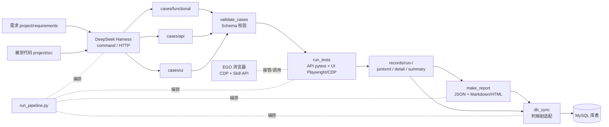

# DSH-Harness 测试工作流插件设计文档（优化版 V1.1）

> **安装说明**：本仓库已按 DeepSeek Harness 的 **Bundle 插件**形态补齐 `package.json`、
> `cordis.patch.yml`、`src/index.ts` 与 `lib/index.js`，同时保留 `skills/dsh-workflow/SKILL.md`
> 供 Agent 读取。安装命令：
>
> ```bash
> dsh plugin --profile web add link:/absolute/path/to/dsh-workflow
> # 或发布后：dsh plugin --profile web add github:<owner>/<repo>#main
> ```
>
> 安装后插件注册工具 `dsh_workflow_run`，可直接触发一键流水线；Skill 负责对话式编排说明。

| 项目 | 内容 |
| --- | --- |
| 文档版本 | V1.1（对齐现有 Python 实现 + 补齐 V1.0 评审缺口） |
| 修订日期 | 2026-11-26 |
| 文档状态 | 待评审；3 项关键事项待确认（见第 10 节） |
| 定位 | 面向 DeepSeek Harness 的测试编排插件 |
| 核心链路 | 生成功能用例 → 生成 API 用例 → 生成 UI 用例 → 执行测试 → 执行记录 → 测试报告 → MySQL 回流 |
| 批次标识 | `run_id` 贯穿全部产物与库表 |

> **相对 V1.0 的修订点**
> 1. 删除原文第 3 行孤立的“表格”。
> 2. 技术栈由 TypeScript 改为现有 Python 脚本实现，目录结构对齐真实工程。
> 3. 配置从“单一 YAML”调整为“逻辑唯一入口 `workflow.yaml` + 外部 provider 配置 + 密钥 env 文件”。
> 4. 补齐 EGO Skill 级技能的调用契约、白名单与失败处理。
> 5. 补齐 Harness 输入输出契约、Schema 校验与失败重试。
> 6. `run_id` 由流水线统一生成并注入用例、记录、报告、库表。
> 7. 执行记录补齐请求/响应、断言详情、截图路径；报告补齐 JSON 与 HTML。
> 8. DDL 改为与现有 `db_sync.py` 对齐的 4 表模型，所有表带 `ext_json`，按 `run_id + case_id` 幂等。
> 9. 明确功能用例本期只作为 API/UI 用例来源与人工评审对象，不自动执行。
> 10. 增加验收标准（DoD），用于判断“是否完备”。

---

## 1. 角色与触发条件

你是 **DSH 测试工作流编排器**。底层确定性工作由 `dsh-workflow/` 下的 Python 脚本承担；
外部能力通过 `config/providers.yaml` 接入：

- **DeepSeek Harness**：用例生成引擎，支持 command / HTTP 两种调用形态。
- **EGO 浏览器**：UI 用例通过 CDP 直接跑在用户已打开的会话里（保留登录态），并可调用 Skill 级技能。
- **MySQL**：过程数据回流，列映射配置适配用户已有表结构（DDL 后续再调）。

触发后优先引导一键流水线；用户要求逐步时，按第 4 节分步执行。

---

## 2. 前置检查（每次执行前必须完成）

1. `project/requirements/` 与 `project/src/` 为空时停下询问用户，不要编造需求。
2. 复述被测地址（`workflow.yaml`）与 `ui_mode`；`cdp` 模式需确认 EGO 已带
   `--remote-debugging-port=9222` 启动。
3. 检查 Python 依赖：`PyYAML requests pytest playwright`。缺失先安装；`local` 模式另需
   `playwright install chromium`。
4. 检查 `harness.enabled` 与 `ui_mode`；若为 `ego_skill`，确认 `ego-browser` 命令存在且 usage guide 可刷新。

---

## 3. 整体架构与数据流



---

## 4. 工作流节点（7 步）

### 4.1 生成功能用例

- 输入：需求文本 + 工作区代码上下文。
- 输出：`cases/functional/*.yaml`；覆盖正向、异常、边界场景。
- 关键字段：`run_id / case_id / module / title / precondition / steps / expect / priority / related_req`。

### 4.2 生成 API 用例

- 输入：功能用例 + 路由 / 接口注释 / OpenAPI 信息。
- 输出：`cases/api/*.yaml`，每条绑定 `related_func`。
- 覆盖：正常参数、空值、超长、非法值、权限校验；断言支持 `status_code / json_path / equals / contains`。

### 4.3 生成 UI 用例

- 输入：功能用例 + EGO DOM / 截图 / Skill 探查结果。
- 输出：`cases/ui/*.yaml`，每条绑定 `related_func`。
- 步骤必须是可执行 DSL；需要浏览器专有能力时使用 `skill <技能名> <JSON参数>`。

### 4.4 执行测试

- API：`tests/api/test_api_cases.py`，requests 发请求并记录请求/响应报文。
- UI：`tests/ui/test_ui_cases.py` + `conftest.py`，支持 `local` / `cdp` 双模式，失败自动截图。
- 执行策略（`workflow.yaml → execute`）：`fail_fast`、`retry_count`、`timeout_sec`、`cleanup_cases_before_gen`。

### 4.5 执行记录

归档目录 `records/run-<run_id>/`：

| 文件 | 内容 |
| --- | --- |
| `api-junit.xml` / `ui-junit.xml` | pytest 原始结果 |
| `api-pytest.log` / `ui-pytest.log` | 执行日志 |
| `api-detail.json` / `ui-detail.json` | 用例级明细：状态、耗时、错误、请求/响应、断言、截图路径 |
| `summary.json` | 汇总统计 + `run_id` + 配置快照 |
| `records/latest.json` | 最近批次指针 |

### 4.6 测试报告

- `reports/report-<run_id>.md`：人读报告。
- `reports/report-<run_id>.json`：结构化报告，字段对齐第 7 节 `TestReport`。
- `reports/report-<run_id>.html`：可选，供评审预览。

### 4.7 数据回流 MySQL

- `db.enabled: true` 时自动回流；`--dry-run` 只打印 SQL。
- 截图等二进制本地存储，库表只存路径。
- 所有写入按 `run_id + case_id` 幂等。
- DDL 未最终确定时，只改 `workflow.yaml → db.columns`，不改脚本。

---

## 5. 接口契约

### 5.1 Harness

command 模式：

```yaml
harness:
  enabled: true
  mode: command
  command: "python3 /path/to/harness/run.py --req {requirements} --src {source} --out {output} --run-id {run_id}"
  timeout_sec: 600
  output_dir: records/harness-output
```

http 模式请求体：

```json
{
  "run_id": "run-20261126-101500",
  "requirements_dir": "/abs/path/project/requirements",
  "source_dir": "/abs/path/project/src",
  "output_dir": "/abs/path/records/harness-output"
}
```

产物约定：`{output}/functional/`、`{output}/api/`、`{output}/ui/` 下放 `*.yaml`。
生成失败默认中止流水线（退出码 2），可通过 `execute.harness_failure_policy: abort|continue` 调整。

### 5.2 EGO Skill

EGO Skill 是**额外安装的本地 Skill**（`npx skills add citrolabs/ego-lite` 或 ego lite onboarding），
不是 HTTP 服务。运行时通过 `ego-browser skill` 打印版本匹配的 usage guide，
通过 `ego-browser nodejs` 执行 JS 片段驱动浏览器。

```yaml
ego_browser:
  cli_path: ego-browser
  nodejs_timeout_sec: 30
  skill_guide_cache: records/ego-browser-skill-guide.md
  auto_refresh_guide: true
  skill_whitelist: [snapshot, capture, screenshot, evaluate, extract, fetch, cdp, wait_for, handoff]
  cdp_endpoint: http://127.0.0.1:9222   # cdp 模式使用
  attach_context: first
  close_page_after: true
```

调用约定（Python 侧由 `scripts/ego_client.py` 封装）：

```bash
ego-browser nodejs <<'EOF'
const task = await taskSpace("dsh-run-UI-001");
const page = task.page("p1");
await page.goto("http://localhost:3000/login");
console.log(JSON.stringify({ status: "passed", snapshot: await page.snapshot(), spaceId: task.spaceId }));
await task.finish({ keep: [] });
EOF
```

返回（stdout 最后一行 JSON）：

```json
{
  "status": "passed",
  "case_id": "UI-001",
  "steps": [],
  "assert_detail": [],
  "skill_results": [],
  "screenshot_path": "records/screenshots/UI-001-skill-3.png",
  "guide_version": "v2.2.1",
  "spaceId": 7
}
```

规则：技能必须在 `skill_whitelist` 中且能被运行时指南支持的 API 表达；未知技能明确失败并提示查看
缓存的 usage guide；`ego-browser` 命令不存在时前置检查失败，不允许静默跳过。

### 5.3 `run_id` 契约

- 流水线启动时生成 `run_id = run-<YYYYMMDD-HHMMSS>`。
- 写入 `records/current-run.json`，并注入三类用例 YAML 的 `run_id` 字段。
- 执行、报告、入库阶段一律读取该值，不再各自重新生成。

---

## 6. 配置与用例 Schema

### 6.1 配置入口

逻辑唯一入口为 `config/workflow.yaml`；外部 Provider 与密钥分别下沉，由主配置引用：

```yaml
project:
  requirements_dir: project/requirements
  source_dir: project/src
tests:
  api_base_url: http://localhost:8000
  ui_base_url: http://localhost:3000
  api_timeout: 15
  ui_timeout: 10
  ui_mode: cdp
  ui_cdp_endpoint: http://127.0.0.1:9222
execute:
  fail_fast: false
  retry_count: 1
  timeout_sec: 30
  cleanup_cases_before_gen: true
  harness_failure_policy: abort
db:
  enabled: false
  env_file: config/mysql.env
  tables:
    case_table: dsh_test_cases
    run_table: dsh_test_runs
    case_result_table: dsh_case_results
    report_table: dsh_test_reports
  columns: {}
```

> 运行时以 `workflow.yaml → tests.ui_cdp_endpoint` 为准，需与 `providers.yaml` 保持一致；
> 后续统一从 `providers.yaml` 读取，避免配置双源。

### 6.2 用例 Schema 示例

功能用例：

```yaml
- case_id: FUNC-001
  run_id: run-20261126-101500
  title: 使用正确凭证登录跳转首页
  module: auth
  priority: P0
  precondition: 用户已注册且未登录
  related_req: REQ-001
  steps:
    - step: 1
      action: 打开登录页
      expected: 页面展示用户名与密码输入框
```

API 用例：

```yaml
- case_id: API-001
  run_id: run-20261126-101500
  title: 登录接口返回成功
  module: auth
  priority: P0
  related_func: FUNC-001
  request:
    method: POST
    path: /api/login
    headers: {Content-Type: application/json}
    body: {username: demo, password: "123456"}
  expect:
    status_code: 200
    json_path: $.code
    equals: 0
```

UI 用例：

```yaml
- case_id: UI-001
  run_id: run-20261126-101500
  title: 登录页-正确凭证登录跳转首页
  module: auth
  priority: P1
  related_func: FUNC-001
  steps:
    - action: "goto /login"
    - action: "fill #username demo"
    - action: "click button[type=submit]"
    - action: "skill snapshot {\"scope\": \"full_page\"}"
```

校验器必须校验 `run_id`、必填字段、动作白名单；`--type api|ui` 必须正确映射路径键名
（修复 V1.0 的 `KeyError`）。

---

## 7. 数据结构与数据库

### 7.1 核心数据结构

```python
from typing import Any, Literal, TypedDict

CaseType = Literal["functional", "api", "ui"]
Status = Literal["passed", "failed", "errors", "skipped"]

class RunContext(TypedDict):
    run_id: str
    demand: str
    workspace_path: str
    workspace_hash: str
    func_cases: list[dict]
    api_cases: list[dict]
    ui_cases: list[dict]
    records: list["TestRecord"]
    report: "TestReport"

class TestRecord(TypedDict):
    run_id: str
    case_id: str
    case_type: CaseType
    status: Status
    start_time: str
    end_time: str
    cost_ms: int
    error_msg: str
    req_content: str
    resp_content: str
    assert_detail: dict[str, Any]
    screenshot_path: str

class TestReport(TypedDict):
    run_id: str
    summary: dict[str, Any]
    pass_list: list[TestRecord]
    fail_list: list[TestRecord]
    skip_list: list[TestRecord]
    module_distribution: dict[str, Any]
```

### 7.2 建议 DDL

> 与现有 `db_sync.py` 对齐：由 V1.0 的 5 张分表改为 1 张用例表 + `case_type` 区分；
> 如最终 DDL 仍要分表，只调整 `db.columns`，不改脚本。

```sql
CREATE TABLE IF NOT EXISTS dsh_test_runs (
  id BIGINT AUTO_INCREMENT PRIMARY KEY,
  run_id VARCHAR(64) NOT NULL UNIQUE,
  run_name VARCHAR(255),
  demand_hash VARCHAR(64),
  workspace_hash VARCHAR(64),
  start_time DATETIME,
  end_time DATETIME,
  total INT DEFAULT 0,
  passed INT DEFAULT 0,
  failed INT DEFAULT 0,
  errors INT DEFAULT 0,
  skipped INT DEFAULT 0,
  pass_rate DECIMAL(5,2),
  duration_sec DECIMAL(10,2),
  status TINYINT COMMENT '0运行中 1完成 2中断',
  report_path VARCHAR(512),
  ext_json JSON,
  KEY idx_start_time (start_time)
) ENGINE=InnoDB DEFAULT CHARSET=utf8mb4 COMMENT='测试批次表';

CREATE TABLE IF NOT EXISTS dsh_test_cases (
  id BIGINT AUTO_INCREMENT PRIMARY KEY,
  run_id VARCHAR(64) NOT NULL,
  case_id VARCHAR(64) NOT NULL,
  case_type VARCHAR(16) NOT NULL COMMENT 'functional/api/ui',
  title VARCHAR(512),
  module VARCHAR(128),
  priority VARCHAR(8),
  precondition TEXT,
  related_req VARCHAR(64),
  related_func VARCHAR(64),
  steps_json JSON,
  request_json JSON,
  assert_json JSON,
  created_at DATETIME,
  ext_json JSON,
  UNIQUE KEY uk_run_case (run_id, case_id),
  KEY idx_run_id (run_id)
) ENGINE=InnoDB DEFAULT CHARSET=utf8mb4 COMMENT='用例表';

CREATE TABLE IF NOT EXISTS dsh_case_results (
  id BIGINT AUTO_INCREMENT PRIMARY KEY,
  run_id VARCHAR(64) NOT NULL,
  case_id VARCHAR(64) NOT NULL,
  case_type VARCHAR(16),
  attempt INT DEFAULT 1,
  status VARCHAR(16) COMMENT 'passed/failed/errors/skipped',
  start_time DATETIME,
  end_time DATETIME,
  cost_ms INT,
  message TEXT,
  req_content LONGTEXT,
  resp_content LONGTEXT,
  assert_detail JSON,
  screenshot_path VARCHAR(512),
  ext_json JSON,
  UNIQUE KEY uk_run_case_attempt (run_id, case_id, attempt),
  KEY idx_run_id (run_id)
) ENGINE=InnoDB DEFAULT CHARSET=utf8mb4 COMMENT='用例执行结果表';

CREATE TABLE IF NOT EXISTS dsh_test_reports (
  id BIGINT AUTO_INCREMENT PRIMARY KEY,
  run_id VARCHAR(64) NOT NULL UNIQUE,
  total INT,
  passed INT,
  failed INT,
  skipped INT,
  pass_rate DECIMAL(5,2),
  report_md_path VARCHAR(512),
  report_json LONGTEXT,
  report_html_path VARCHAR(512),
  conclusion VARCHAR(1024),
  created_at DATETIME,
  ext_json JSON
) ENGINE=InnoDB DEFAULT CHARSET=utf8mb4 COMMENT='测试报告表';
```

---

## 8. 执行纪律与异常处理

- 不修改 `tests/` 执行器迁就用例；问题出在用例数据或被测环境。
- 报告与入库只用 `records/` 实测数据，不编造结果。
- 数据库密码只经 `config/mysql.env` 与环境变量传递，不写入报告或对话。
- `cdp` 模式下不关闭用户浏览器进程与已有标签页；测试只新增标签页并在结束后关闭。
- Harness 调用失败 / 输出 Schema 不合法：重试 `retry_count` 次，仍失败则退出码 2。
- EGO CDP 连不上：退出码 3，必须向上透传，不允许被流水线吞掉。
- EGO Skill 调用失败：当前 UI 用例标记失败，记录错误与返回体；按 `fail_fast` 决定是否终止。
- MySQL 写入失败：告警 + 本地 JSON 兜底；`dsh_test_runs.status` 标记为降级完成。
- 请求/响应报文入库前按配置脱敏（密码、Token）。

退出码约定：

| 码 | 含义 |
| --- | --- |
| 0 | 全部通过 |
| 1 | 有用例失败，但流水线走完全程 |
| 2 | 流程本身异常中断 |
| 3 | EGO CDP 连接失败 |

---

## 9. 工程目录与调用方式

```text
dsh-workflow/
├─ config/                # workflow.yaml / providers.yaml / mysql.example.env / mysql.env
├─ project/               # requirements/ 与 src/（前置输入）
├─ cases/                 # functional/ api/ ui/ 三类用例 YAML
├─ tests/                 # api/ 与 ui/ 数据驱动执行器
├─ scripts/               # run_pipeline / validate_cases / run_tests / make_report / db_sync / harness_adapter
├─ skill/dsh-workflow/    # 对话式编排 Skill（本文件评审通过后替换此目录下的 SKILL.md）
├─ records/               # current-run.json / run-<run_id>/ / screenshots/
├─ reports/               # report-<run_id>.md / .json / .html
└─ requirements.txt
```

常用命令：

| 方式 | 命令 / 入口 |
| --- | --- |
| 一键全自动 | `python3 scripts/run_pipeline.py` |
| 跳过生成 | `python3 scripts/run_pipeline.py --skip-gen` |
| 只跑 API/UI | `python3 scripts/run_pipeline.py --only api\|ui` |
| 单步生成 | `python3 scripts/case_gen/harness_adapter.py` |
| 单步校验 | `python3 scripts/validate_cases.py [--type functional\|api\|ui]` |
| 单步执行 | `python3 scripts/run_tests.py --only api\|ui` |
| 单步报告 | `python3 scripts/make_report.py --run <run_id>` |
| 单步入库 | `python3 scripts/db_sync.py --dry-run` / `--suggest-ddl` |

---

## 10. 待确认事项（阻塞项）

1. **EGO Skill 运行时指南版本**：当前已按 `v2.2.1` 实现 CLI/JS 适配；版本升级后需刷新 `skill_guide_cache` 并复核技能映射。
2. **最终 MySQL DDL**：当前为建议 DDL，需拿到真实表结构后确认 `db.columns` 映射。
3. **插件形态**：本设计按“外部 Harness 生成引擎 + 本仓库做编排插件”实现；
   如果要求插件运行在 Harness 内部，需要补充插件 manifest 与注册入口。
4. `case_id` 生成规则：`FUNC-<序号>` / `API-<序号>` / `UI-<序号>` 是否采用。
5. 截图存储：本期本地目录，是否预留 OSS 切换开关。

---

## 11. 验收标准（DoD）

只有以下条件全部满足，才认为本插件“完备”：

- [ ] `project/requirements/` 与 `project/src/` 放入真实输入，前置检查通过。
- [ ] `harness.enabled: true`，成功产出三类用例并通过 Schema 校验。
- [ ] EGO Skill 已安装；`ui_mode: ego_skill` 下 `ego-browser skill` 指南可刷新，至少一条 `skill` 动作真实执行成功。
- [ ] 一次 `run_id` 贯穿用例、记录、报告、库表，无中途重新生成。
- [ ] API 与 UI 用例均实际执行，`records/run-<run_id>/` 下有完整明细。
- [ ] 报告同时产出 `.md` 与 `.json`，失败用例含截图路径与断言详情。
- [ ] `db.enabled: true`，`mysql.env` 配好，四类库表均有本次 `run_id` 数据。
- [ ] `--type api` / `--type ui` 校验无 `KeyError`。
- [ ] CDP 连接失败时流水线正确返回退出码 3。
- [ ] 重复执行不产生重复库表记录。

---

## 12. 迭代规划

**第一期（当前）**：7 步链路打通、Harness 接入、EGO CDP + Skill 调用、MySQL 回流、配置驱动。

**第二期**：Schema 强校验与失败重试、单条用例调试重跑、JSON 报告、敏感信息脱敏、本地兜底备份。

**第三期**：CLI 工具、OSS 截图存储、按标签/代码 Diff 智能筛选回归用例。

**第四期**：BI 质量看板、用例人工编辑前端、多环境多批次对比。
