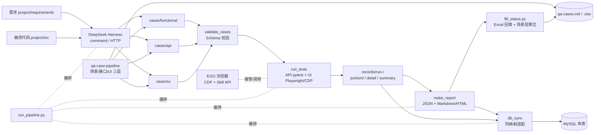

# DSH-Harness 测试工作流插件设计文档（优化版 V1.2）

> **安装说明**：本仓库已按 DeepSeek Harness 的 **Bundle 插件**形态补齐 `package.json`、
> `cordis.patch.yml`、`src/index.ts` 与 `lib/index.js`，同时保留 `skills/dsh-workflow/SKILL.md`
> 供 Agent 读取。安装命令：
>
> ```bash
> dsh plugin --profile web add link:/absolute/path/to/dsh-workflow
> # 或发布后：dsh plugin --profile web add github:<owner>/<repo>#main
> ```
>
> 安装后插件注册工具 `dsh_workflow_run`，可直接触发一键流水线；Skill 负责对话式编排说明。
> 若未提供被测系统链接，工具会通过 DSH `ctx.userQuestions` 弹窗收集链接、SSO 账号与密码并确认，
> 再启动 EGO、尽力登录；无法自动登录时通过 `task.handOff()` 把浏览器交还用户手动登录。

| 项目 | 内容 |
| --- | --- |
| 文档版本 | V1.2（V1.1 + qa-toolkit / qa-case-pipeline 三层用例集成） |
| 修订日期 | 2026-11-26 |
| 文档状态 | 待评审；3 项关键事项待确认（见第 10 节） |
| 定位 | 面向 DeepSeek Harness 的测试编排插件 |
| 核心链路 | 生成功能用例 → 生成 API 用例 → 生成 UI 用例 → 执行测试 → 执行记录 → 测试报告（含场景层聚合与 Excel 回填）→ MySQL 回流 |
| 批次标识 | `run_id` 贯穿全部产物与库表 |

> **相对 V1.1 的修订点**
> 1. 新增 **qa-case-pipeline** 用例生成引擎（`harness.provider: qa_casepipe`），产出场景/接口/UI 三层用例。
> 2. 新增 qa-toolkit 状态回填：执行明细 → Excel「执行状态」列 + COUNTIF 统计 + 场景层聚合。
> 3. 报告新增「场景层状态统计」章节，结构化报告新增 `qa_pipeline` 字段。
> 4. 插件读取宿主注入的 `ctx.qaCasepipe`（`dsh-qa-casepipe` 插件提供），把脚本目录透传给 Python 脚本。
> 5. 预检新增 qa_casepipe 检查项（spec 存在性、scripts 可达性），缺一即阻塞。

> **相对 V1.0 的修订点**
> 1. 删除原文第 3 行孤立的“表格”。
> 2. 技术栈由 TypeScript 改为现有 Python 脚本实现，目录结构对齐真实工程。
> 3. 配置从“单一 YAML”调整为“逻辑唯一入口 `workflow.yaml` + 外部 provider 配置 + 密钥 env 文件”。
> 4. 补齐 EGO Skill 级技能的调用契约、白名单与失败处理。
> 5. 补齐 Harness 输入输出契约、Schema 校验与失败重试。
> 6. `run_id` 由流水线统一生成并注入用例、记录、报告、库表。
> 7. 执行记录补齐请求/响应、断言详情、截图路径；报告补齐 JSON 与 HTML。
> 8. DDL 改为与现有 `db_sync.py` 对齐的 4 表模型，所有表带 `ext_json`，按 `run_id + case_id` 幂等。
> 9. 明确功能用例本期只作为 API/UI 用例来源与人工评审对象，不自动执行。
> 10. 增加验收标准（DoD），用于判断“是否完备”。

---

## 1. 角色与触发条件

你是 **DSH 测试工作流编排器**。底层确定性工作由 `dsh-workflow/` 下的 Python 脚本承担；
外部能力通过 `config/providers.yaml` 接入：

- **DeepSeek Harness**：用例生成引擎，支持 command / HTTP 两种调用形态。
- **qa-toolkit（qa-case-pipeline）**：三层用例引擎（场景 / 接口 / UI），产出 Markdown + Excel 用例集，
  并在执行后回填状态、聚合场景层结论；也可只作为「回填器」与 Harness 共存。
- **EGO 浏览器**：UI 用例通过 CDP 直接跑在用户已打开的会话里（保留登录态），并可调用 Skill 级技能。
- **MySQL**：过程数据回流，列映射配置适配用户已有表结构（DDL 后续再调）。

识别到“全链路测试”意图后，先执行第 2.4 节预检与步骤计划，用户确认后再执行；
用户要求逐步时，按第 4 节分步执行。

---

## 2. 前置检查（每次执行前必须完成）

1. `project/requirements/` 与 `project/src/` 为空时停下询问用户，不要编造需求。
2. 复述被测地址（`workflow.yaml`）与 `ui_mode`；`cdp` 模式需确认 EGO 已带
   `--remote-debugging-port=9222` 启动。
3. 检查 Python 依赖：`PyYAML requests pytest playwright`。缺失先安装；`local` 模式另需
   `playwright install chromium`。
4. 检查 `harness.enabled` 与 `ui_mode`；若为 `ego_skill`，确认 `ego-browser` 命令存在且 usage guide 可刷新。
5. 若 `harness.provider: qa_casepipe` 或 `qa_casepipe.enabled: true`，确认 spec 文件存在、
   qa-case-pipeline 的 `gen_cases.py` / `fill_status.py` 可达（缺一即阻塞）。

### 2.4 只读预检与工作流步骤计划（新增）

一旦确认用户要做“全链路测试”，必须先执行只读预检，再生成步骤计划并让用户确认，**确认前不得启动浏览器、登录或写库**。

- 实现：`scripts/preflight.py`，只读输出 `{ ok, blockers, warnings, checks, plan }`。
- 检查项：需求/代码目录、用例数量、生成引擎接入（harness / qa_casepipe）、EGO CLI 与指南、
  Python 依赖、UI 模式、MySQL env 与列映射。
- 步骤计划：准备目标系统 → 生成三类用例 → 格式校验 → 执行 API/UI → 生成报告 →（可选）Excel 状态回填 → MySQL 回流。
- 用户确认：通过 `ctx.userQuestions.ask()` 展示计划并提供 `开始执行 / 取消`；
  没有弹窗服务时返回计划并要求带 `confirmed=true` 重新调用。
- 阻塞项处理：存在 blocker 时直接返回，不进入任何执行阶段。

### 2.5 被测系统链接与 SSO 登录（新增）

当对话中没有提供被测系统链接时，不得臆造地址。插件工具 `dsh_workflow_run` 会：

1. 通过 `ctx.userQuestions.ask()` 弹出表单，依次收集：
   - `被测系统链接`（必须 `http://` 或 `https://`）
   - `SSO 账号`
   - `SSO 密码`
   - 确认项：`确认并启动` / `取消`
2. 用户确认后调用 `scripts/prepare_target.py`：
   - macOS 下若 EGO 未运行，执行 `open -a "ego lite"` 启动；
   - 等待 `ego-browser` 命令可用；
   - 用 `ego-browser nodejs` 打开被测链接并探查登录表单；
   - 若存在密码输入框，尽力填入账号/密码并提交；
   - 若自动登录成功，关闭本次 TaskSpace 并继续流水线；
   - 若无法自动登录，保存截图并调用 `task.handOff()`，提示用户在 EGO 浏览器中手动登录后再重试。
3. 安全约束：
   - 密码只通过进程环境变量一次性传递，不写配置、用例、报告、记录或 MySQL；
   - 工具返回文本中所有出现的密码都会被替换为 `***`；
   - 用户取消或没有提问弹窗服务时，不启动浏览器，返回明确提示。

---

## 3. 整体架构与数据流



---

## 4. 工作流节点（7 步）

### 4.1 生成功能用例

- 输入：需求文本 + 工作区代码上下文。
- 输出：`cases/functional/*.yaml`；覆盖正向、异常、边界场景。
- 关键字段：`run_id / case_id / module / title / precondition / steps / expect / priority / related_req`。

### 4.2 生成 API 用例

- 输入：功能用例 + 路由 / 接口注释 / OpenAPI 信息。
- 输出：`cases/api/*.yaml`，每条绑定 `related_func`。
- 覆盖：正常参数、空值、超长、非法值、权限校验；断言支持 `status_code / json_path / equals / contains`。

### 4.3 生成 UI 用例

- 输入：功能用例 + EGO DOM / 截图 / Skill 探查结果。
- 输出：`cases/ui/*.yaml`，每条绑定 `related_func`。
- 步骤必须是可执行 DSL；需要浏览器专有能力时使用 `skill <技能名> <JSON参数>`。

### 4.4 执行测试

- API：`tests/api/test_api_cases.py`，requests 发请求并记录请求/响应报文。
- UI：`tests/ui/test_ui_cases.py` + `conftest.py`，支持 `local` / `cdp` 双模式，失败自动截图。
- 执行策略（`workflow.yaml → execute`）：`fail_fast`、`retry_count`、`timeout_sec`、`cleanup_cases_before_gen`。

### 4.5 执行记录

归档目录 `records/run-<run_id>/`：

| 文件 | 内容 |
| --- | --- |
| `api-junit.xml` / `ui-junit.xml` | pytest 原始结果 |
| `api-pytest.log` / `ui-pytest.log` | 执行日志 |
| `api-detail.json` / `ui-detail.json` | 用例级明细：状态、耗时、错误、请求/响应、断言、截图路径 |
| `summary.json` | 汇总统计 + `run_id` + 配置快照 |
| `playwright/` | Playwright 定位脚本产物（`*.e2e.ts` + `index.ts` + `playwright.config.ts` + `manifest.json`） |
| `bugs.json` | 本批次缺陷快照（发现/复现 + 仍未关闭的缺陷） |
| `records/bugs.json` | 缺陷台账主表（跨批次累积，含要素、状态、流转留痕） |
| `records/latest.json` | 最近批次指针 |

### 4.6 测试报告

- `reports/report-<run_id>.md`：人读报告。
- `reports/report-<run_id>.json`：结构化报告，字段对齐第 7 节 `TestReport`。
- `reports/report-<run_id>.html`：可选，供评审预览。
- `qa_casepipe.enabled: true` 时额外产出：Markdown「场景层状态统计」章节 +
  JSON 的 `qa_pipeline` 字段（场景级结论与回填结果）。
- 有缺陷时追加「缺陷清单（过程发现）」章节：状态/级别统计 + 明细表 +
  每条缺陷的基本要素与流转轨迹；JSON 同步带 `bugs` 与 `bug_stats` 字段。
- 有 Playwright 脚本产物时追加「Playwright 定位脚本产物」章节（模块/脚本/用例数/SHA1）；
  JSON 同步带 `playwright_scripts` 字段。

### 4.8 用例集状态回填与场景层聚合（qa_casepipe.enabled: true）

- 执行明细 → qa-case-pipeline 状态词表：`passed→通过`、`failed→失败`、`errors→阻塞`、`skipped→未执行`，
  结果写入 `records/<run_id>/qa-casepipe-results.json`。
- 调用 `fill_status.py`：先回填 UI 层工作表，再回填接口层工作表并按 `related` 关系聚合场景层
  （失败 > 部分通过 > 阻塞 > 通过 > 未执行），同时在「统计与说明」工作表写 COUNTIF 统计。
- 回填失败不阻断流水线：报告里标注「状态回填未完成」并保留原因。

### 4.7 数据回流 MySQL

- `db.enabled: true` 时自动回流；`--dry-run` 只打印 SQL。
- 截图等二进制本地存储，库表只存路径。
- 所有写入按 `run_id + case_id` 幂等。
- 缺陷按 `run_id + bug_id` 幂等。
- DDL 未最终确定时，只改 `workflow.yaml → db.columns`，不改脚本。

### 4.9 缺陷台账（过程发现即留痕）

执行阶段结束后，`run_tests.py` 扫描 api / ui / functional 明细中
`status ∈ {failed, errors}` 的用例，自动并入缺陷台账（`scripts/bug_tracker.py`）。

| 行为 | 规则 |
| --- | --- |
| 同根因归并 | 指纹 = `sha1(模块 + 归一化错误签名)`，数字/UUID/长 hex 归一化后相同的失败视为同一根因，只开一单 |
| 关联用例累积 | 归并的多个用例全部记入 `case_ids`，主用例保留首个 |
| 跨批次累加 | 再次出现只累加 `occurrences` 与 `seen_runs`，不重复开单 |
| 自动重开 | `已关闭` / `已拒绝` 的缺陷复现 → 自动置 `重新打开` 并留痕 |
| 要素补全 | 执行明细缺的模块/优先级/标题/步骤/期望，从 `cases/*.yaml` 补齐 |

缺陷基本要素：编号、指纹、错误签名、标题、严重级别、优先级、模块、状态、
关联用例、用例类型、描述、前置条件、复现步骤、期望结果、实际结果、
请求/响应内容、断言明细、截图证据、报告人、处理人、复现次数、
首见/出现批次、发现/确认/修复/关闭时间、流转记录 `history`。

状态机（非法流转直接拒绝并提示合法后继）：

```
新建 → 已确认 → 修复中 → 待验证 → 已关闭
  ↓      ↓        ↑        ↑        ↓
已拒绝 ←┘        已确认 ←──┘     重新打开
  ↑                               ↓
  └────── 重新打开 ──────────────┘
```

命令：

```bash
python3 scripts/bug_tracker.py list | show --bug-id BUG-xxx | stats
python3 scripts/bug_tracker.py add --title "..." --module auth --priority P1
python3 scripts/bug_tracker.py status --bug-id BUG-xxx --to confirmed --by 张三 --assignee 李四
python3 scripts/bug_tracker.py assign --bug-id BUG-xxx --assignee 李四
python3 scripts/bug_tracker.py sync --run <run_id>
```

### 4.10 Playwright 定位脚本产物

UI 自动化不只产出执行明细，还会**从同一份 `cases/ui/*.yaml` DSL 生成 Playwright
定位脚本**（`scripts/gen_playwright.py`），与 Harness 侧 `e2e_gen_playwright` 产物形态一致。

- `run_tests.py` 每次执行后自动生成；也可单独调用 `gen_playwright.py --run <run_id>`
- `--import <dir>` 可导入已有的生成脚本（如 Harness 产出的 `e2e/playwright-dsh/`），
  manifest 中标记 `script_mode: imported`
- DSL → TS：`goto` / `wait` / `click` / `fill` / `press` / `check` / `select` / `hover` /
  `expect_url_contains` / `expect_text` / `expect_visible` / `screenshot` 全部逐条翻译并保留步骤注释；
  `skill` 动作显式注释「Playwright 原生不支持」，绝不静默跳过
- 按 `case_id` 前两段分组：`UI-NAV-001` → `UI-NAV` → `ui-nav.e2e.ts`
- 产物落点：`records/<run_id>/playwright/`；报告列脚本清单；
  MySQL 复用 `dsh_test_cases.ext_json` 写 `script_path` / `script_sha1` /
  `script_generator` / `script_generated_at` / `script_mode`，无需改表结构
- 配置：`workflow.yaml → playwright.enabled / inject_auth / storage`

### 4.11 外部插件能力完整接入（ego-browser / qa-toolkit）

dsh-workflow 是编排层，复用两个插件的原生能力，不复制其代码。

**ego-browser**（`scripts/ego_client.py` / `scripts/ego_learnings.py`）：
- 基础 DSL：goto / click / fill / press / check / select / wait / screenshot + 三类断言
- 视觉交互：mouse_click / mouse_move / mouse_wheel / key_press / type_text / paste / insert_text
- 页面与弹窗：reload / wait_function / popup / accept_dialog / dismiss_dialog /
  new_page / adopt / release / user_page / pages / tabs
- 文件：upload（绝对路径、`|` 分隔多文件）/ download（saveAs 到本地绝对路径）
- Skill 白名单扩展到 18 项：`ego_browser.skill_whitelist`，含 mouse/keyboard/popup/
  upload/download/adopt/release/user_page/new_page/pages/tabs/wait_function/reload/
  clear_state/clear_cookies/claim_space
- 领域工具包（GitHub / Google / X）：`ego_learnings.py list | run | snippet`；
  探测顺序为 `DSH_EGO_LEARNINGS_DIR`、`ego_browser.learnings_dir`、
  `ego-browser/learnings`、DSH profile 安装目录

**qa-toolkit**（`scripts/qa_casepipe.py` / `scripts/qa_extended.py`）：
- 主链路：gen_cases.py（三层用例 MD+Excel）、fill_status.py（回填+COUNTIF+场景聚合）、
  spec→cases/*.yaml、translate_playwright_steps（Playwright 片段→DSL）
- 扩展能力（`qa_casepipe.extended`，按项开关，失败不阻断）：
  login.mjs（登录 storageState）、api_runner.js（真实 API 执行+断言+capture）、
  ui_spec_template.ts（模板）、references/*.md（规范）、qa_review.py（产物审核）
- 结果写 `records/<run_id>/qa-extended.json`，报告生成「qa-toolkit 扩展能力」章节
- 兼容：插件包声明 `type: module` 但脚本用 `require()` 时，自动以临时 `.cjs` 执行

---

## 5. 接口契约

### 5.1 Harness

command 模式：

```yaml
harness:
  enabled: true
  mode: command
  command: "python3 /path/to/harness/run.py --req {requirements} --src {source} --out {output} --run-id {run_id}"
  timeout_sec: 600
  output_dir: ../dsh-workflow-tmp/harness-output
```

http 模式请求体：

```json
{
  "run_id": "run-20261126-101500",
  "requirements_dir": "/abs/path/project/requirements",
  "source_dir": "/abs/path/project/src",
  "output_dir": "/abs/path/../dsh-workflow-tmp/harness-output"
}
```

产物约定：`{output}/functional/`、`{output}/api/`、`{output}/ui/` 下放 `*.yaml`。
生成失败默认中止流水线（退出码 2），可通过 `execute.harness_failure_policy: abort|continue` 调整。

### 5.2 EGO Skill

EGO Skill 是**额外安装的本地 Skill**（`npx skills add citrolabs/ego-lite` 或 ego lite onboarding），
不是 HTTP 服务。运行时通过 `ego-browser skill` 打印版本匹配的 usage guide，
通过 `ego-browser nodejs` 执行 JS 片段驱动浏览器。

```yaml
ego_browser:
  cli_path: ego-browser
  nodejs_timeout_sec: 30
  skill_guide_cache: ../dsh-workflow-tmp/ego-browser-skill-guide.md
  auto_refresh_guide: true
  skill_whitelist: [snapshot, capture, screenshot, evaluate, extract, fetch, cdp, wait_for, handoff]
  cdp_endpoint: http://127.0.0.1:9222   # cdp 模式使用
  attach_context: first
  close_page_after: true
```

调用约定（Python 侧由 `scripts/ego_client.py` 封装）：

```bash
ego-browser nodejs <<'EOF'
const task = await taskSpace("dsh-run-UI-001");
const page = task.page("p1");
await page.goto("http://localhost:3000/login");
console.log(JSON.stringify({ status: "passed", snapshot: await page.snapshot(), spaceId: task.spaceId }));
await task.finish({ keep: [] });
EOF
```

返回（stdout 最后一行 JSON）：

```json
{
  "status": "passed",
  "case_id": "UI-001",
  "steps": [],
  "assert_detail": [],
  "skill_results": [],
  "screenshot_path": "records/screenshots/UI-001-skill-3.png",
  "guide_version": "v2.2.1",
  "spaceId": 7
}
```

规则：技能必须在 `skill_whitelist` 中且能被运行时指南支持的 API 表达；未知技能明确失败并提示查看
缓存的 usage guide；`ego-browser` 命令不存在时前置检查失败，不允许静默跳过。

### 5.3 `run_id` 契约

- 流水线启动时生成 `run_id = run-<YYYYMMDD-HHMMSS>`。
- 写入 `records/current-run.json`，并注入三类用例 YAML 的 `run_id` 字段。
- 执行、报告、入库阶段一律读取该值，不再各自重新生成。

### 5.4 qa-case-pipeline 契约

配置（`config/providers.yaml`）：

```yaml
harness:
  enabled: true
  provider: qa_casepipe        # harness | qa_casepipe
qa_casepipe:
  enabled: true
  spec: project/requirements/qa-spec.json
  scripts_dir: ""              # 留空自动探测
  outputs:
    md: reports/qa-cases.md
    xlsx: reports/qa-cases.xlsx
  sheets:
    scenario: 核心链路用例
    api: API接口用例
    ui: UI用例(Playwright)
```

spec 结构（`qa-toolkit/skill/qa-case-pipeline/scripts/spec.example.json` 为样例）：

```json
{
  "meta": {"title": "...", "version": "v1.0", "env": "...", "base": "https://host/api"},
  "scenarios": [{"id": "TC-AUTH-001", "chain": "A 登录与会话", "name": "...", "priority": "P0",
                 "precondition": "...", "steps": "...", "expected": "...",
                 "related": ["TC-API-005", "TC-UI-001"]}],
  "api": [{"id": "TC-API-005", "related": "TC-AUTH-001", "module": "权限", "name": "...",
           "method": "POST", "url": "{base}/rbac/runtime/context", "headers": "Accept: application/json",
           "body": "无请求体", "expect": "...", "negative": "...", "priority": "P0",
           "assert": {"status": 200, "code": 0, "dataKeys": ["permissions"]}}],
  "ui": [{"id": "TC-UI-001", "related": "TC-AUTH-001", "module": "登录", "name": "...",
          "precondition_ui": "无", "steps_playwright": "await page.goto(`${BASE}/#/x`);", "expected": "..."}]
}
```

转换规则：

| spec 层 | DSH 用例 | 关键映射 |
| --- | --- | --- |
| `scenarios` | `cases/functional/qa-pipeline.functional.yaml` | `steps` 文本化，`related` → `related_req` |
| `api` | `cases/api/qa-pipeline.api.yaml` | `assert.status`→`expect.status_code`、`assert.code`→`expect.json_path=$.code`+`equals`、`url` 去掉 base 前缀、`{{token}}`/`{{clientId}}` 占位符由环境变量替换 |
| `ui` | `cases/ui/qa-pipeline.ui.yaml` | Playwright 片段保守翻译为 EGO DSL；无法翻译的断言写进 `notes` 并在日志提示 |

脚本定位顺序：`qa_casepipe.scripts_dir` → `DSH_QACASEPIPE_DIR`（由插件从 `ctx.qaCasepipe.skillDir` 注入）
→ `node_modules/dsh-qa-casepipe/assets/qa-case-pipeline/scripts` → 同级 `../qa-toolkit/skill/qa-case-pipeline/scripts`
→ `~/.dsh/profiles/*/node_modules/dsh-qa-casepipe/assets/qa-case-pipeline/scripts`。

---

## 6. 配置与用例 Schema

### 6.1 配置入口

逻辑唯一入口为 `config/workflow.yaml`；外部 Provider 与密钥分别下沉，由主配置引用：

```yaml
project:
  requirements_dir: project/requirements
  source_dir: project/src
tests:
  api_base_url: http://localhost:8000
  ui_base_url: http://localhost:3000
  api_timeout: 15
  ui_timeout: 10
  ui_mode: cdp
  ui_cdp_endpoint: http://127.0.0.1:9222
execute:
  fail_fast: false
  retry_count: 1
  timeout_sec: 30
  cleanup_cases_before_gen: true
  harness_failure_policy: abort
db:
  enabled: false
  env_file: config/mysql.env
  tables:
    case_table: dsh_test_cases
    run_table: dsh_test_runs
    case_result_table: dsh_case_results
    report_table: dsh_test_reports
  columns: {}
```

`config/providers.yaml` 额外承载外部接入：

```yaml
harness:
  enabled: true
  provider: qa_casepipe      # harness | qa_casepipe
  mode: command               # command | http
qa_casepipe:
  enabled: true
  spec: project/requirements/qa-spec.json
  scripts_dir: ""
  outputs: {md: reports/qa-cases.md, xlsx: reports/qa-cases.xlsx}
ego_browser:
  cli_path: ego-browser
  skill_whitelist: [snapshot, capture, screenshot, evaluate, extract, fetch, cdp, wait_for, handoff]
```

> 运行时以 `workflow.yaml → tests.ui_cdp_endpoint` 为准，需与 `providers.yaml` 保持一致；
> 后续统一从 `providers.yaml` 读取，避免配置双源。

### 6.2 用例 Schema 示例

功能用例：

```yaml
- case_id: FUNC-001
  run_id: run-20261126-101500
  title: 使用正确凭证登录跳转首页
  module: auth
  priority: P0
  precondition: 用户已注册且未登录
  related_req: REQ-001
  steps:
    - step: 1
      action: 打开登录页
      expected: 页面展示用户名与密码输入框
```

API 用例：

```yaml
- case_id: API-001
  run_id: run-20261126-101500
  title: 登录接口返回成功
  module: auth
  priority: P0
  related_func: FUNC-001
  request:
    method: POST
    path: /api/login
    headers: {Content-Type: application/json}
    body: {username: demo, password: "123456"}
  expect:
    status_code: 200
    json_path: $.code
    equals: 0
```

UI 用例：

```yaml
- case_id: UI-001
  run_id: run-20261126-101500
  title: 登录页-正确凭证登录跳转首页
  module: auth
  priority: P1
  related_func: FUNC-001
  steps:
    - action: "goto /login"
    - action: "fill #username demo"
    - action: "click button[type=submit]"
    - action: "skill snapshot {\"scope\": \"full_page\"}"
```

校验器必须校验 `run_id`、必填字段、动作白名单；`--type api|ui` 必须正确映射路径键名
（修复 V1.0 的 `KeyError`）。

---

## 7. 数据结构与数据库

### 7.1 核心数据结构

```python
from typing import Any, Literal, TypedDict

CaseType = Literal["functional", "api", "ui"]
Status = Literal["passed", "failed", "errors", "skipped"]

class RunContext(TypedDict):
    run_id: str
    demand: str
    workspace_path: str
    workspace_hash: str
    func_cases: list[dict]
    api_cases: list[dict]
    ui_cases: list[dict]
    records: list["TestRecord"]
    report: "TestReport"

class TestRecord(TypedDict):
    run_id: str
    case_id: str
    case_type: CaseType
    status: Status
    start_time: str
    end_time: str
    cost_ms: int
    error_msg: str
    req_content: str
    resp_content: str
    assert_detail: dict[str, Any]
    screenshot_path: str

class TestReport(TypedDict):
    run_id: str
    summary: dict[str, Any]
    pass_list: list[TestRecord]
    fail_list: list[TestRecord]
    skip_list: list[TestRecord]
    bugs: list["BugRecord"]
    bug_stats: dict[str, Any]
    module_distribution: dict[str, Any]

BugStatus = Literal["new", "confirmed", "fixing", "verifying",
                    "closed", "reopened", "rejected"]
BugSeverity = Literal["blocker", "critical", "major", "minor", "trivial"]

class BugRecord(TypedDict):
    bug_id: str
    fingerprint: str
    error_signature: str
    title: str
    severity: BugSeverity
    priority: str
    module: str
    status: BugStatus
    case_id: str
    case_ids: list[str]
    case_type: CaseType
    description: str
    precondition: str
    steps: list[str]
    expected: str
    actual: str
    req_content: str
    resp_content: str
    assert_detail: list[dict[str, Any]]
    screenshot_path: str
    reporter: str
    assignee: str
    occurrences: int
    first_run_id: str
    seen_runs: list[str]
    found_at: str
    last_seen_at: str
    confirmed_at: str
    fixed_at: str
    closed_at: str
    history: list[dict[str, Any]]
```

### 7.2 建议 DDL

> 与现有 `db_sync.py` 对齐：由 V1.0 的 5 张分表改为 1 张用例表 + `case_type` 区分；
> 如最终 DDL 仍要分表，只调整 `db.columns`，不改脚本。

```sql
CREATE TABLE IF NOT EXISTS dsh_test_runs (
  id BIGINT AUTO_INCREMENT PRIMARY KEY,
  run_id VARCHAR(64) NOT NULL UNIQUE,
  run_name VARCHAR(255),
  demand_hash VARCHAR(64),
  workspace_hash VARCHAR(64),
  start_time DATETIME,
  end_time DATETIME,
  total INT DEFAULT 0,
  passed INT DEFAULT 0,
  failed INT DEFAULT 0,
  errors INT DEFAULT 0,
  skipped INT DEFAULT 0,
  pass_rate DECIMAL(5,2),
  duration_sec DECIMAL(10,2),
  status TINYINT COMMENT '0运行中 1完成 2中断',
  report_path VARCHAR(512),
  ext_json JSON,
  KEY idx_start_time (start_time)
) ENGINE=InnoDB DEFAULT CHARSET=utf8mb4 COMMENT='测试批次表';

CREATE TABLE IF NOT EXISTS dsh_test_cases (
  id BIGINT AUTO_INCREMENT PRIMARY KEY,
  run_id VARCHAR(64) NOT NULL,
  case_id VARCHAR(64) NOT NULL,
  case_type VARCHAR(16) NOT NULL COMMENT 'functional/api/ui',
  title VARCHAR(512),
  module VARCHAR(128),
  priority VARCHAR(8),
  precondition TEXT,
  related_req VARCHAR(64),
  related_func VARCHAR(64),
  steps_json JSON,
  request_json JSON,
  assert_json JSON,
  created_at DATETIME,
  ext_json JSON,
  UNIQUE KEY uk_run_case (run_id, case_id),
  KEY idx_run_id (run_id)
) ENGINE=InnoDB DEFAULT CHARSET=utf8mb4 COMMENT='用例表';

CREATE TABLE IF NOT EXISTS dsh_case_results (
  id BIGINT AUTO_INCREMENT PRIMARY KEY,
  run_id VARCHAR(64) NOT NULL,
  case_id VARCHAR(64) NOT NULL,
  case_type VARCHAR(16),
  attempt INT DEFAULT 1,
  status VARCHAR(16) COMMENT 'passed/failed/errors/skipped',
  start_time DATETIME,
  end_time DATETIME,
  cost_ms INT,
  message TEXT,
  req_content LONGTEXT,
  resp_content LONGTEXT,
  assert_detail JSON,
  screenshot_path VARCHAR(512),
  ext_json JSON,
  UNIQUE KEY uk_run_case_attempt (run_id, case_id, attempt),
  KEY idx_run_id (run_id)
) ENGINE=InnoDB DEFAULT CHARSET=utf8mb4 COMMENT='用例执行结果表';

CREATE TABLE IF NOT EXISTS dsh_test_reports (
  id BIGINT AUTO_INCREMENT PRIMARY KEY,
  run_id VARCHAR(64) NOT NULL UNIQUE,
  total INT,
  passed INT,
  failed INT,
  skipped INT,
  pass_rate DECIMAL(5,2),
  report_md_path VARCHAR(512),
  report_json LONGTEXT,
  report_html_path VARCHAR(512),
  conclusion VARCHAR(1024),
  created_at DATETIME,
  ext_json JSON
) ENGINE=InnoDB DEFAULT CHARSET=utf8mb4 COMMENT='测试报告表';

CREATE TABLE IF NOT EXISTS dsh_test_bugs (
  id BIGINT AUTO_INCREMENT PRIMARY KEY,
  run_id VARCHAR(64) NOT NULL,
  bug_id VARCHAR(64) NOT NULL,
  title VARCHAR(512),
  severity VARCHAR(16) COMMENT 'blocker/critical/major/minor/trivial',
  priority VARCHAR(8),
  module VARCHAR(128),
  status VARCHAR(16) COMMENT 'new/confirmed/fixing/verifying/closed/reopened/rejected',
  case_id VARCHAR(64),
  case_type VARCHAR(16),
  description TEXT,
  steps_json JSON,
  expected TEXT,
  actual TEXT,
  req_content LONGTEXT,
  resp_content LONGTEXT,
  assert_detail JSON,
  screenshot_path VARCHAR(512),
  reporter VARCHAR(64),
  assignee VARCHAR(64),
  occurrences INT DEFAULT 1,
  first_run_id VARCHAR(64),
  found_at DATETIME,
  confirmed_at DATETIME,
  fixed_at DATETIME,
  closed_at DATETIME,
  ext_json JSON,
  UNIQUE KEY uk_run_bug (run_id, bug_id),
  KEY idx_run_id (run_id),
  KEY idx_status (status),
  KEY idx_severity (severity)
) ENGINE=InnoDB DEFAULT CHARSET=utf8mb4 COMMENT='测试缺陷台账表';
```

---

## 8. 执行纪律与异常处理

- 不修改 `tests/` 执行器迁就用例；问题出在用例数据或被测环境。
- 报告与入库只用 `records/` 实测数据，不编造结果。
- 数据库密码只经 `config/mysql.env` 与环境变量传递，不写入报告或对话。
- `cdp` 模式下不关闭用户浏览器进程与已有标签页；测试只新增标签页并在结束后关闭。
- Harness 调用失败 / 输出 Schema 不合法：重试 `retry_count` 次，仍失败则退出码 2。
- EGO CDP 连不上：退出码 3，必须向上透传，不允许被流水线吞掉。
- EGO Skill 调用失败：当前 UI 用例标记失败，记录错误与返回体；按 `fail_fast` 决定是否终止。
- MySQL 写入失败：告警 + 本地 JSON 兜底；`dsh_test_runs.status` 标记为降级完成。
- 请求/响应报文入库前按配置脱敏（密码、Token）。

退出码约定：

| 码 | 含义 |
| --- | --- |
| 0 | 全部通过 |
| 1 | 有用例失败，但流水线走完全程 |
| 2 | 流程本身异常中断 |
| 3 | EGO CDP 连接失败 |

---

## 9. 工程目录与调用方式

```text
dsh-workflow/
├─ config/                # workflow.yaml / providers.yaml / mysql.example.env / mysql.env
├─ project/               # requirements/ 与 src/（前置输入）
├─ cases/                 # functional/ api/ ui/ 三类用例 YAML
├─ tests/                 # api/ 与 ui/ 数据驱动执行器
├─ scripts/               # run_pipeline / validate_cases / run_tests / make_report / db_sync / harness_adapter / qa_casepipe / bug_tracker / gen_playwright / ego_client / ego_learnings / qa_extended
├─ skill/dsh-workflow/    # 对话式编排 Skill（本文件评审通过后替换此目录下的 SKILL.md）
├─ records/               # current-run.json / run-<run_id>/（含 playwright/ 脚本产物）/ screenshots/
├─ reports/               # report-<run_id>.md / .json / .html + qa-cases.md / .xlsx
└─ requirements.txt
```

常用命令：

| 方式 | 命令 / 入口 |
| --- | --- |
| 一键全自动 | `python3 scripts/run_pipeline.py` |
| 跳过生成 | `python3 scripts/run_pipeline.py --skip-gen` |
| 只跑 API/UI | `python3 scripts/run_pipeline.py --only api\|ui` |
| 单步生成 | `python3 scripts/case_gen/harness_adapter.py`（`--dry-run` 只查配置） |
| 单步校验 | `python3 scripts/validate_cases.py [--type functional\|api\|ui]` |
| 单步执行 | `python3 scripts/run_tests.py --only api\|ui` |
| 单步报告 | `python3 scripts/make_report.py --run <run_id>`（含场景层聚合与 Excel 回填） |
| 单步入库 | `python3 scripts/db_sync.py --dry-run` / `--suggest-ddl` |
| 缺陷台账 | `python3 scripts/bug_tracker.py list\|show\|stats\|status\|assign\|add\|sync` |
| 生成 Playwright 脚本 | `python3 scripts/gen_playwright.py [--run <run_id>] [--dry-run]` |
| 导入已有脚本 | `python3 scripts/gen_playwright.py --import <dir> --run <run_id>` |
| qa-toolkit 扩展 | `python3 scripts/qa_extended.py [--run <run_id>] [--dry-run]` |
| ego 领域工具 | `python3 scripts/ego_learnings.py list \| run \| snippet` |

---

## 10. 待确认事项（阻塞项）

1. **EGO Skill 运行时指南版本**：当前已按 `v2.2.1` 实现 CLI/JS 适配；版本升级后需刷新 `skill_guide_cache` 并复核技能映射。
2. **最终 MySQL DDL**：当前为建议 DDL，需拿到真实表结构后确认 `db.columns` 映射。
3. **插件形态**：本设计按“外部 Harness 生成引擎 + 本仓库做编排插件”实现；
   如果要求插件运行在 Harness 内部，需要补充插件 manifest 与注册入口。
4. `case_id` 生成规则：`FUNC-<序号>` / `API-<序号>` / `UI-<序号>` 是否采用。
5. 截图存储：本期本地目录，是否预留 OSS 切换开关。

---

## 11. 验收标准（DoD）

只有以下条件全部满足，才认为本插件“完备”：

- [ ] `project/requirements/` 与 `project/src/` 放入真实输入，前置检查通过。
- [ ] `harness.enabled: true`，成功产出三类用例并通过 Schema 校验。
- [ ] （可选）`harness.provider: qa_casepipe` 时三层用例落到 `cases/`，Excel/Markdown 用例集已生成。
- [ ] （可选）`qa_casepipe.enabled: true` 时 Excel 回填成功，场景层状态统计与用例明细一致。
- [ ] EGO Skill 已安装；`ui_mode: ego_skill` 下 `ego-browser skill` 指南可刷新，至少一条 `skill` 动作真实执行成功。
- [ ] 一次 `run_id` 贯穿用例、记录、报告、库表，无中途重新生成。
- [ ] API 与 UI 用例均实际执行，`records/run-<run_id>/` 下有完整明细。
- [ ] 报告同时产出 `.md` 与 `.json`，失败用例含截图路径与断言详情。
- [ ] `db.enabled: true`，`mysql.env` 配好，四类库表均有本次 `run_id` 数据。
- [ ] `--type api` / `--type ui` 校验无 `KeyError`。
- [ ] CDP 连接失败时流水线正确返回退出码 3。
- [ ] 重复执行不产生重复库表记录。

---

## 12. 迭代规划

**第一期（当前）**：7 步链路打通、Harness 接入、EGO CDP + Skill 调用、MySQL 回流、配置驱动。

**第二期**：Schema 强校验与失败重试、单条用例调试重跑、JSON 报告、敏感信息脱敏、本地兜底备份。

**第三期**：CLI 工具、OSS 截图存储、按标签/代码 Diff 智能筛选回归用例。

**第四期**：BI 质量看板、用例人工编辑前端、多环境多批次对比。
